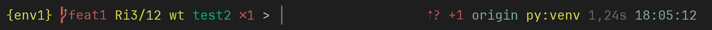
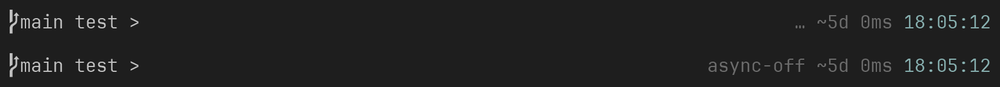
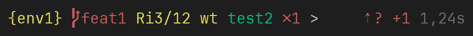

Prompt theme for Windows+cmd+[Clink](https://github.com/chrisant996/clink) rendering Git status while focusing on speed and concise info using caching and async techniques to ensure snappiness at all times.

## Speed

### Cached rendering

  * Renders the left and right prompts from cached values: **18µs** per pair in the sample below. Git collection runs asynchronously.
  * Keeps the last result visible while a refresh is pending; status glyphs are dimmed until the new result arrives.
  * Blank Enter reuses fresh git status without spawning a Git process.
  * Status-neutral commands (```cls```, ```dir```, ```type```, ```git log```, ```git diff```, ... with no redirection) also reuse fresh status. The default reuse window is 10 seconds, including blank Enter.
  * ```cd``` within the same repo retains the repository cache object - no field copying, blank flash, or extra git run.

### Background updates

  * Collects status, upstream counts, and stash count in one async porcelain process. There is no separate stash process or synchronous stash probe.
  * Reuses the untracked count between full scans (2 seconds by default); commands that can change files force a full scan.
  * Async status survives Enter: on a slow repo the refresh lands on a later prompt instead of being canceled and restarted by every command.
  * A short-lived idle metadata watcher notices identity/config/action/ref updates (including reftable repositories) without Clink stretching its cadence. Ref-only changes reuse the throttled untracked count. It deliberately does not scan the working tree.
  * Async status runs with ```--no-optional-locks``` so it never takes ```index.lock``` and never collides with git commands typed at the prompt.
  * One-time hint to enable ```core.fsmonitor``` when git status is repeatedly slow.

### Bounds and recovery

  * Streams and time-slices status parsing to a ~1ms budget so huge outputs cannot monopolize the input thread.
  * Bounds status parsing at 100,000 changed paths by default; ```≥100000``` marks counts as lower bounds. Obsolete refreshes are coalesced to at most two status processes.
  * Applies status transactionally: repository generations and before/after metadata signatures prevent stale or cross-repository results from entering the cache.
  * Refuses to fall back to blocking Git when ```prompt.async=false``` (the prompt shows ```async-off```).
  * Skips Git integration when either the working directory or Git metadata is remote/UNC because filesystem calls can block unpredictably.
  * An internal error never breaks the prompt: the status stays dimmed and the error is printed once at the next prompt boundary.

### Benchmark

Measured on **2026-10-17** in this repository (12 tracked files), with default Snapline settings: Windows build 26200, Intel Core i9-13900K, Clink 1.9.34, Git 2.45.1.windows.1. Values are the mean per call after one warmup: 1,000 calls for cached rendering and metadata, 25 for each subprocess path. These are results for a small local repository; Git collection time depends on the repository and machine.

  * Cached left + right render: **18µs**.
  * Full status collection, including untracked paths: **36ms**.
  * Status collection with the untracked count reused: **35ms**.
  * The collection times include Git and parsing; normal prompt rendering does not wait for them. The benchmark command itself runs synchronously.
  * Results are grouped by work type and sorted by duration within each group. Red means more than 10ms per call.
  * Type ```snapline-bench``` at the prompt to re-measure on your machine. [Recorded output](resources/benchmark.txt).

    

## Info

### Left prompt

  * virtual environment in yellow, e.g. ```{env1}```
  * git branch
  * git in-progress action; rebase and mail-apply actions include step/total progress when available, e.g. ```Ri3/12```
  * exceptional repository markers: ```LOCK``` for an index lock, ```sh``` for a shallow clone, ```sp``` for sparse checkout, ```wt``` for a linked worktree, and ```sub``` for a submodule
  * current working directory
    * no-repo in white
    * clean in green
    * dirty in red (untracked paths found in the repository)
  * last exit code in red when nonzero, e.g. ```✗1 >``` (negative codes shown as hex NTSTATUS, e.g. ```✗0xC0000005 >```)
### Right prompt

  * git status glyphs (dimmed while an async refresh is still pending, dim ```…``` while the first status for a repo is collected)
  * ```⇡?``` when an upstream is configured but ahead/behind is unknown (upstream gone, or ```ahead_behind=false```)
  * git upstream, abbreviated to the remote name when it matches the current branch
  * dim ```~3d``` when the last fetch is older than 3 days (configurable) - ahead/behind may be outdated
  * stash count and Python environment/version hint, e.g. ```≡2``` and ```py3.12:venv``` (```py:venv``` when the version is unavailable)
  * ```≥N``` when the status entry limit is reached, and ```async-off``` when Clink asynchronous prompts are disabled
  * duration of every submitted line, including an exact zero as ```0ms```
  * current time
  * width-aware layout: ancillary fields are removed progressively; command duration has highest retention priority, followed by Git/stash state when space permits
## git

  * branch
    * clean in green
    * dirty in red
    * hidden outside a repository
  * in-progress actions, progress, repository markers, and prompt markers
    <p align="center"></p>
  * status legend, grouped into commits/stash, working tree/index, and freshness/limits
    <p align="center"></p>
  * type ```snapline-legend``` at the prompt to print both legends with your configured glyphs

## Examples

Examples rendered from the current implementation with fixed sample states and command durations. The durations in these strips are illustrative; measured render and collection times are in the benchmark above.

* dirty branch 'heureka': 1 modified file, 1 untracked path, 2 stash items; untracked paths also make the directory red; upstream is abbreviated to 'origin', last fetched 5 days ago


* active virtual environment 'env1', clean branch and directory; 1 commit ahead and 2 behind origin; an exact zero command duration remains visible as ```0ms```


* virtual environment 'env1', dirty branch 'feat1', merge in progress, 1 conflicted file and 1 untracked path


* interactive rebase at step 3 of 12 in a linked worktree; 1 staged file, unknown ahead/behind counts, and last command exit code 1


* first status still collecting (top) and async prompts disabled (bottom), both in a 90-column terminal


* the rebase example in a separate 50-column terminal; the right prompt stays at the terminal's right edge, keeping command duration and Git counts while dropping ancillary fields

  

## Transient prompt

Past prompts can collapse to just the exit marker (```> ``` or ```✗1 > ```) with the submit time on the right, keeping scrollback compact. Opt in with:

    clink set prompt.transient always


## Configuration

All knobs live in the ```config``` table at the top of ```snapline.lua``` (reuse window, untracked scan interval, status entry bound, local/remote repository policy, repo watcher, adaptive right-prompt layout, ahead/behind counts, fetch age, duration threshold, colors, glyphs, ...). A wrapper script loaded before snapline can also define a global ```snapline_config``` table to override entries without editing the file. Partial ```color```, ```status_format```, ```action_symbol```, and ```repo_state_symbol``` tables are merged with their defaults. Invalid or unknown options are ignored with a one-time message.

## Installation

Copy the ```.lua``` file into Clink configuration folder. Ensure terminal uses Nerd Fonts. Requires Clink 1.7.0 or newer (the script silently no-ops on older versions). When another ```.clinkprompt``` is selected, Snapline automatically stands down instead of mixing two prompts.

## Tests

Run the integration-style harness with Clink's Lua runtime:

    clink lua test\harness.lua
